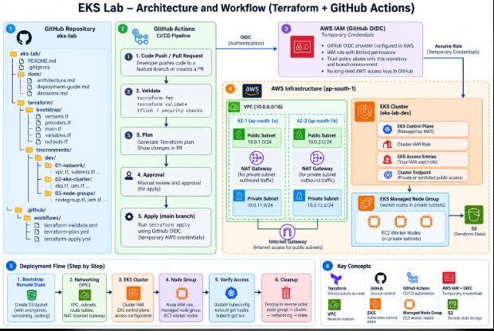

# EKS Lab — Simple Architecture Notes

## 1. What are we building?

We are building a Kubernetes platform on AWS using Terraform.

Our goal is to create the infrastructure automatically instead of creating everything manually in the AWS Console.

## 2. Tools we will use

- **GitHub:** Stores our project code.
- **Terraform:** Creates and manages AWS resources.
- **GitHub Actions:** Automatically checks and runs our Terraform code.
- **AWS IAM:** Controls who can access AWS resources.
- **GitHub OIDC:** Allows GitHub Actions to access AWS using temporary credentials.
- **Amazon EKS:** Runs and manages Kubernetes.
- **EC2:** Provides the worker machines that run our applications.
- **S3:** Stores our Terraform state file.

## 3. How does everything work together?

1. We write Terraform code on our local machine.
2. We push the code to GitHub.
3. GitHub Actions checks whether the Terraform code is valid.
4. Terraform creates a plan showing what will change.
5. We review the plan and approve the deployment.
6. GitHub Actions gets temporary AWS credentials through OIDC.
7. Terraform creates the AWS infrastructure.

## 4. What infrastructure will we create?

### Step 1: VPC and Networking

A VPC is our private network in AWS.

Inside the VPC, we create subnets, route tables, and the required network connections. Worker nodes will run in private subnets.

### Step 2: EKS Cluster

EKS provides the Kubernetes control plane. It manages the cluster and coordinates the worker nodes.

### Step 3: Managed Node Group

A managed node group provides EC2 worker machines where our Kubernetes applications run.

### Step 4: Terraform State

Terraform state records the resources Terraform manages. We will store it securely in an S3 bucket so it can be used safely by our team and automation.

## 5. Why do we separate Terraform files?

We separate files to keep the code organized and easy to understand.

- `versions.tf` — defines required Terraform and provider versions.
- `providers.tf` — configures the AWS provider.
- `variables.tf` — defines input variables.
- `locals.tf` — defines reusable values.
- `vpc.tf` — creates the VPC.
- `subnets.tf` — creates subnets.
- `routes.tf` — configures network routes.
- `iam.tf` — defines IAM roles and permissions.
- `eks.tf` — creates the EKS cluster.
- `nodegroup.tf` — creates the managed node group.
- `outputs.tf` — displays useful information after deployment.

Terraform reads all `.tf` files in the same directory as one configuration.

## 6. Our implementation order

1. Create the repository structure and documentation.
2. Configure Terraform versions and the AWS provider.
3. Define variables and common settings.
4. Create the remote state backend.
5. Create the VPC and networking.
6. Create the EKS cluster.
7. Create the managed node group.
8. Configure GitHub Actions and OIDC.
9. Verify Kubernetes access and deploy a sample application.
10. Clean up the resources when finished.

## 7. Important security rules

- Never push AWS access keys or secrets to GitHub.
- Use separate IAM roles for the EKS cluster and worker nodes.
- Restrict access to the EKS API endpoint.
- Keep Terraform state secure.
- Review the Terraform plan before applying changes.
- Check AWS costs before creating resources.

## Final Goal

Build an EKS platform using Terraform and GitHub Actions while learning how DevOps teams design, deploy, secure, and manage infrastructure in real projects.

